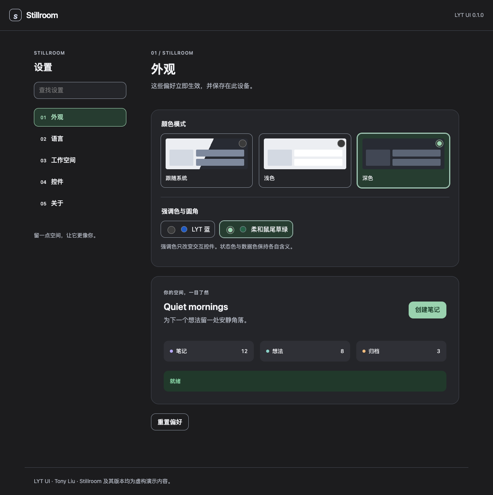

# LYT UI

[简体中文](README.zh-CN.md)

LYT UI is Tony Liu’s personal interface design system, packaged as an AI skill. It gives a new product a familiar settings experience, from its first appearance in the system theme to the version number in **Settings → About**. The defaults pair neutral surfaces and system type with a restrained blue accent. The design originated in PathBlender and can be used independently in any product.



## Use the skill in a project

1. Clone this repository. With Node.js 22 or later, run `npm run build` in the repository root. The build uses Node’s built-in modules and requires no package installation.
2. Copy the entire generated `dist/skill/` directory into your AI tool’s skills directory, naming the copy `lyt-ui`. Keep the references, assets, license and generated version file together. You can also point a coding assistant directly at the [source skill](skills/lyt-ui/SKILL.md).
3. In your product’s working directory, ask the assistant to apply the skill to a specific screen. For example:

> Use $lyt-ui to update the settings screen in my reading-list app. Preserve the books and any unsaved draft. Add a system, light and dark appearance choice, an English and Chinese language selector, and the app’s own version in About. Show me the result at desktop and phone widths.

The [settings guide](skills/lyt-ui/references/settings.md) covers immediate preferences, forms with Save and Cancel, release channels and build details. The [language guide](skills/lyt-ui/references/i18n.md) covers native language names, search, fallback and right-to-left layout. Choose shipped languages according to the translations your product maintains.

## Try the web reference

From the repository root:

```sh
npm run build
npm run dev
```

Open [Stillroom on localhost](http://127.0.0.1:4173). Type a workspace name and leave it unsaved. Switch the theme or language, then return to Workspace to check your draft. Try **Sage** to see how a second preset changes the controls while preserving the meaning of status and data colors. On a narrow screen, the language picker opens as a sheet.

For a second example, run `npm run trial`. Enter the temporary directory it prints and run `PORT=4174 node serve.mjs .`. Open [Shelf on localhost](http://127.0.0.1:4174) to add a book, mark it read and filter the list.

## Customize a fork

Edit the [theme tokens](skills/lyt-ui/assets/tokens.json). Start with the existing `sage` preset for a small override. Its light and dark sections define the accent, label, selected background and focus colors. Its common section adjusts the control and panel radii. Typography and spacing live in the top-level common section. See the [token roles and merge order](skills/lyt-ui/references/foundations.md). If you add a named preset, expose it in the consuming app’s preference choices.

Run `npm run verify` to exercise the theme and state tests and check package contents, then rebuild and inspect the changed UI. Browser interaction checks are separate. The [handoff](HANDOFF.md) includes their commands and the original test record.

## Platform coverage

| Target | Available here |
| --- | --- |
| Web | Framework-independent tokens, CSS and JavaScript helpers, two runnable examples and Chromium test evidence |
| Desktop apps | Guidance for menus, keyboard input, preferences and update capabilities |
| iOS and Android | Guidance for touch targets, navigation, text scaling, safe areas and the software keyboard |

The desktop and mobile guidance requires implementation and testing in the consuming app. The mobile screenshots show responsive web layouts. See [platform guidance](skills/lyt-ui/references/platforms.md) and [verification guidance](skills/lyt-ui/references/verification.md).

MIT © 2026 Tony Liu. See the [license](LICENSE) and [design provenance](skills/lyt-ui/references/provenance.md).
