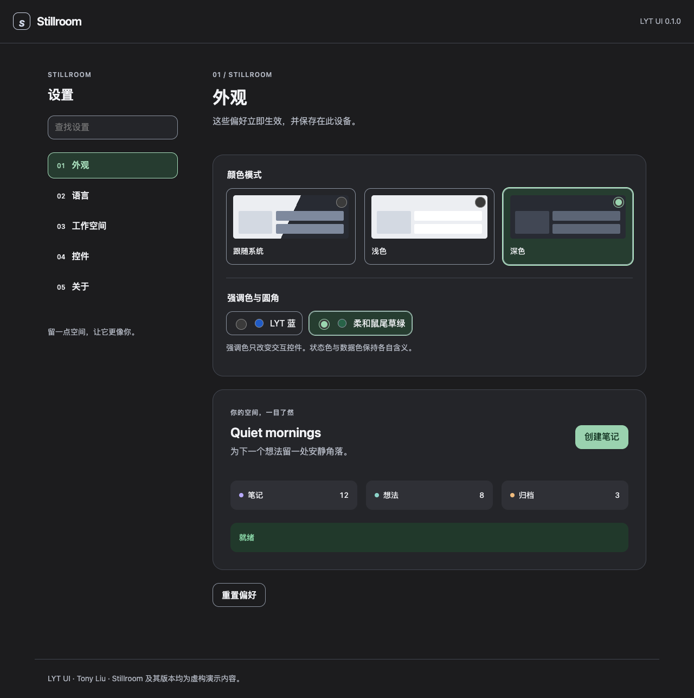

# LYT UI

[English](README.md)

LYT UI 是 Tony Liu 的个人界面设计体系，以 AI skill 的形式分发。它把源自 PathBlender 的界面习惯带到其他产品中：浅灰与近黑的界面底色、蓝色操作控件、系统字体，以及一致的设置、语言选择和版本查看方式。书单、写作工具或手机应用都可以采用这套设计。



## 在自己的项目中使用

1. 下载或克隆仓库，在根目录用 Node.js 22 或以上版本执行 `npm run build`。构建使用 Node 内置模块，无需安装 npm 依赖。
2. 把生成的整个 `dist/skill/` 目录复制到 AI 工具支持的技能目录，并把副本命名为 `lyt-ui`。保留其中的规范、主题资源、许可证和生成的版本文件。也可以让能读取本地文件的助手直接打开[源码入口](skills/lyt-ui/SKILL.md)。
3. 在你的产品目录里告诉助手要改哪个界面。例如：

> 使用 $lyt-ui 改造我的书单应用设置页。保留已收藏的书和未保存的输入。外观提供跟随系统、浅色、深色三个选项，语言支持简体中文和英语，在「设置 → 关于」显示书单应用自身的版本。分别检查电脑和手机宽度下的效果。

[设置规范](skills/lyt-ui/references/settings.md)解释了哪些选项立即生效、哪些表单需要保存，以及正式版、预发布版和构建信息怎么展示。[语言规范](skills/lyt-ui/references/i18n.md)说明了语言自称、搜索、回退和从右向左排版。每个产品可按实际维护的译文选择上线语言。

## 运行示例

在仓库根目录执行：

```sh
npm run build
npm run dev
```

打开[本机 Stillroom 演示](http://127.0.0.1:4173)。可以在「工作空间」输入名称，先不保存，换主题或语言后再回来看草稿。切换到鼠尾草绿预设，可以观察按钮和圆角如何变化，以及状态色和数据色如何保持一致。把窗口缩窄，语言选择器会切换成底部面板。

另一个示例是书单 Shelf。执行 `npm run trial`，进入输出的临时目录，再执行 `PORT=4174 node serve.mjs .`。打开[本机 Shelf 演示](http://127.0.0.1:4174)，可以添加书目、标记已读和筛选未读。

## Fork 后怎么换风格

从[主题配置](skills/lyt-ui/assets/tokens.json)里的 `sage` 预设入手。它分别定义浅色和深色下的按钮、文字、选中背景和焦点颜色，共用的部分调整控件与面板圆角。字体和间距在顶层的 `common` 中。新增预设时，在使用它的应用中添加对应选项。[视觉规范](skills/lyt-ui/references/foundations.md)列出了各项用途和覆盖顺序。

修改后执行 `npm run verify`，检查主题、状态和打包资源，然后重新构建并查看实际界面。浏览器交互需要单独运行；[交接记录](HANDOFF.md)包含运行方法和初次交付时的测试记录。

## 平台支持

| 平台 | 仓库提供的内容 |
| --- | --- |
| 网站 | 通用主题、CSS 和 JavaScript 辅助代码、两个可运行示例及 Chromium 测试记录 |
| 桌面软件 | 菜单、键盘操作、偏好设置和更新入口的适配规范 |
| iOS、Android | 触控、导航、字体缩放、安全区域与软键盘的适配规范 |

桌面和手机原生界面需要在具体应用中实现并验证。目前的手机截图来自响应式网页。详见[平台适配](skills/lyt-ui/references/platforms.md)和[验收指南](skills/lyt-ui/references/verification.md)。

MIT © 2026 Tony Liu。[许可证](LICENSE) · [设计来源与取舍](skills/lyt-ui/references/provenance.md)
